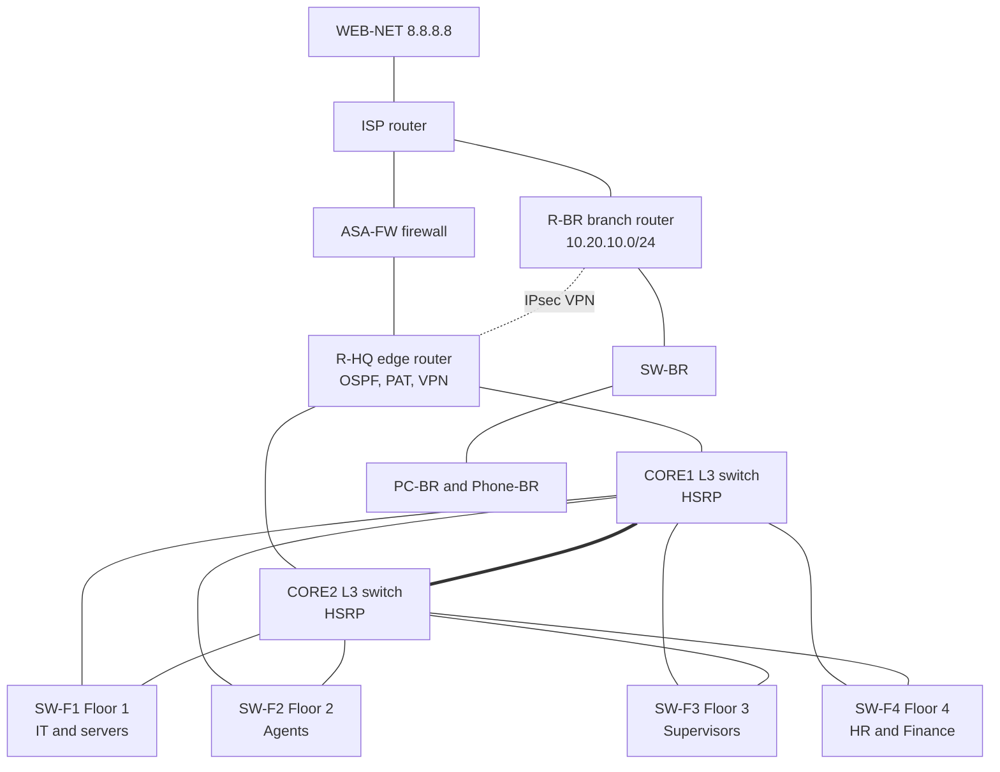

# BPO Call Center Network (Cisco Packet Tracer)
 
A simulated enterprise network for a BPO / call center: a four-floor headquarters (one department per floor) and a branch office connected by a site-to-site VPN. It demonstrates redundant gateways (HSRP), dynamic routing (OSPF, with EIGRP as an alternative), NAT/PAT, an ASA firewall, department-based access control and IP telephony.
 
> **Status:** designed in Cisco Packet Tracer. Add your own screenshot of the finished topology here, and your `.pkt` file to the repository.
 
## Table of contents
 
1. [Features](#features)
2. [Topology](#topology)
3. [Devices](#devices)
4. [Addressing plan](#addressing-plan)
5. [VLANs and departments](#vlans-and-departments)
6. [Access control matrix](#access-control-matrix)
7. [Configuration highlights](#configuration-highlights)
8. [Build order](#build-order)
9. [Verification checklist](#verification-checklist)
10. [Troubleshooting](#troubleshooting)
11. [Production considerations](#production-considerations)
12. [What I learned](#what-i-learned)
## Features
 
| Area | Implementation |
| --- | --- |
| Segmentation | 7 VLANs, one per department plus servers, management and voice |
| High availability | HSRP on two core L3 switches, load shared across VLANs, with rapid-PVST root placement matched to the active gateway |
| Routing | OSPF area 0 between cores and edge router, with a default route originated by the edge. EIGRP configured as an alternative |
| Internet access | PAT (NAT overload) on the edge router, with VPN traffic excluded from translation |
| Firewall | Cisco ASA with security levels and an inbound ACL that permits only VPN negotiation from the branch |
| VPN | Site-to-site IPsec (IKE phase 1 and 2, AES-256, SHA, pre-shared key) between HQ and the branch |
| Access control | Layer 1: extended ACLs on the cores. Layer 2: FTP accounts with different permissions per department |
| Voice | Cisco CME call manager with department extension ranges, phones at HQ and the branch (via VPN) |
| DHCP | Central DHCP server with one pool per VLAN, relayed by the cores (`ip helper-address`), plus a local pool at the branch |
 
## Topology
 

 
Every floor switch has two uplinks, one to each core, so the loss of either core does not isolate a floor. The VPN tunnel runs over the same physical path as normal internet traffic (R-HQ, ASA, ISP, R-BR).
 
## Devices
 
| Name | Packet Tracer model | Role |
| --- | --- | --- |
| CORE1, CORE2 | Multilayer switch 3650-24PS | Inter-VLAN routing, HSRP pair, OSPF |
| SW-F1 to SW-F4 | Switch 2960-24TT | Floor access switches |
| R-HQ | Router 2911 | Edge router: OSPF, PAT, VPN |
| ASA-FW | ASA 5506-X | Perimeter firewall |
| ISP | Router 2911 | Simulated internet |
| R-BR | Router 1941 | Branch router, VPN peer, local DHCP |
| SW-BR | Switch 2960-24TT | Branch switch |
| VOICE-GW | Router 2811 | Call manager (CME) and voice DHCP |
| SRV-INFRA, FILE-HR, FILE-OPS, WEB-NET | Server-PT | DHCP/DNS, HR files, operations files, internet test server |
| PCs and IP Phone 7960 | PC-PT, phone | One PC and one phone per department, plus the branch |
 
If your Packet Tracer version rejects `standby` on the 3650, use the 3560-24PS for the cores (adjust port names and add `switchport trunk encapsulation dot1q`).
 
## Addressing plan
 
The third octet of each HQ subnet matches its VLAN ID. In every VLAN, `.1` is the HSRP virtual gateway, `.2` is CORE1 and `.3` is CORE2.
 
| Link or device | Address |
| --- | --- |
| R-HQ to CORE1 | 10.10.0.0/30 (R-HQ .1, CORE1 .2) |
| R-HQ to CORE2 | 10.10.0.4/30 (R-HQ .5, CORE2 .6) |
| CORE1 to CORE2 (routed) | 10.10.0.8/30 (.9 and .10) |
| R-HQ to ASA | 203.0.113.0/30 (ASA .1, R-HQ .2) |
| ASA to ISP | 203.0.113.4/30 (ASA .5, ISP .6) |
| ISP to R-BR | 198.51.100.0/30 (ISP .1, R-BR .2) |
| ISP to WEB-NET | 8.8.8.0/24 (ISP .1, WEB-NET .8) |
| Branch LAN | 10.20.10.0/24 (R-BR .1) |
| SRV-INFRA (DHCP, DNS) | 10.10.50.10 |
| FILE-HR | 10.10.50.20 |
| FILE-OPS | 10.10.50.30 |
| VOICE-GW | 10.10.50.5 |
 
The 203.0.113.0/24 and 198.51.100.0/24 ranges are reserved documentation addresses used here as stand-ins for public IPs.
 
## VLANs and departments
 
| VLAN | Name | Floor and department | Subnet | HSRP active |
| --- | --- | --- | --- | --- |
| 10 | AGENTS | Floor 2, call agents | 10.10.10.0/24 | CORE1 |
| 20 | SUPERVISORS | Floor 3, supervisors and QA | 10.10.20.0/24 | CORE2 |
| 30 | HR_FIN | Floor 4, HR and finance | 10.10.30.0/24 | CORE1 |
| 40 | IT | Floor 1, IT staff | 10.10.40.0/24 | CORE2 |
| 50 | SERVERS | Floor 1, server room | 10.10.50.0/24 | CORE1 |
| 99 | MGMT | Switch management | 10.10.99.0/24 | CORE2 |
| 100 | VOICE | IP phones | 10.10.100.0/24 | CORE2 |
 
## Access control matrix
 
| Source | FILE-HR | FILE-OPS | HR/Finance PCs | Phone calls |
| --- | --- | --- | --- | --- |
| IT (VLAN 40) | Full | Full | Yes | Yes |
| Agents (VLAN 10) | Blocked | Read only | Blocked | Yes |
| Supervisors (VLAN 20) | Blocked | Read and write | Yes | Yes |
| HR/Finance (VLAN 30) | Full | Blocked | Yes | Yes |
| Branch (10.20.10.0/24) | Blocked | Read only | Blocked | Yes |
 
Enforcement happens in two layers. An ACL on the cores decides which subnet can reach which server, and FTP accounts on the file servers decide what an authenticated user can do (for example, the `agent` account is read only).
 
Phone extensions: 1001 Agents, 2001 Supervisors, 3001 HR/Finance, 4001 IT, 5001 Branch. Every department can dial every other one.
 
## Configuration highlights
 
These are short excerpts. They are not complete configurations.
 
**HSRP on a core (VLAN 10 on CORE1)**
 
```
interface vlan 10
 ip address 10.10.10.2 255.255.255.0
 ip helper-address 10.10.50.10
 standby 10 ip 10.10.10.1
 standby 10 priority 110
 standby 10 preempt
```
 
**OSPF on a core**
 
```
router ospf 1
 router-id 2.2.2.1
 passive-interface default
 no passive-interface g1/0/22
 no passive-interface g1/0/24
 network 10.10.0.0 0.0.255.255 area 0
```
 
**PAT on R-HQ (VPN traffic excluded)**
 
```
ip access-list extended NAT-ACL
 deny ip 10.10.0.0 0.0.255.255 10.20.10.0 0.0.0.255
 permit ip 10.10.0.0 0.0.255.255 any
ip nat inside source list NAT-ACL interface g0/2 overload
```
 
**Site-to-site VPN on R-HQ**
 
```
crypto isakmp policy 10
 encryption aes 256
 hash sha
 authentication pre-share
 group 2
crypto isakmp key <pre-shared-key> address 198.51.100.2
crypto ipsec transform-set TS esp-aes 256 esp-sha-hmac
ip access-list extended VPN-ACL
 permit ip 10.10.0.0 0.0.255.255 10.20.10.0 0.0.0.255
crypto map CMAP 10 ipsec-isakmp
 set peer 198.51.100.2
 set transform-set TS
 match address VPN-ACL
```
 
The branch router mirrors this with the peer, key and ACL reversed. Use your own key and do not commit real secrets.
 
**Department ACL on the server VLAN (excerpt)**
 
```
ip access-list extended TO-SERVERS
 permit ip 10.10.40.0 0.0.0.255 any
 permit tcp 10.10.30.0 0.0.0.255 host 10.10.50.20 eq 21
 permit tcp 10.10.10.0 0.0.0.255 host 10.10.50.30 eq 21
 permit tcp 10.10.20.0 0.0.0.255 host 10.10.50.30 eq 21
interface vlan 50
 ip access-group TO-SERVERS out
```
 
## Build order
 
Test after every step instead of building everything first.
 
1. Access switches: VLANs, trunks, access ports, PortFast
2. Cores: SVIs, HSRP, spanning-tree roots, DHCP relay
3. Routing: OSPF on R-HQ and both cores (optionally EIGRP)
4. R-HQ: PAT and default route
5. ISP and ASA firewall
6. Branch router and IPsec VPN (enable the `securityk9` licence and reload first)
7. Servers: DHCP pools, FTP accounts, then the ACLs
8. Telephony: CME, DHCP option 150, extensions
## Verification checklist
 
| Test | Command or action | Expected result |
| --- | --- | --- |
| VLANs and trunks | `show vlan brief`, `show interfaces trunk` | VLANs listed, uplinks trunking |
| HSRP roles | `show standby brief` | CORE1 active for 10, 30, 50. CORE2 active for 20, 40, 99, 100 |
| DHCP | PCs set to DHCP | Address from own VLAN, gateway ends in .1 |
| OSPF | `show ip ospf neighbor` on R-HQ | Both cores FULL |
| PAT | Ping 8.8.8.8, `show ip nat translations` | Private hosts translated to 203.0.113.2 |
| Firewall | Ping 203.0.113.2 from WEB-NET | Fails |
| VPN | Ping 10.10.10.1 from PC-BR, `show crypto isakmp sa` | Replies after first timeout, QM_IDLE |
| Permissions | FTP from agent PC to FILE-HR and FILE-OPS | FILE-HR blocked, FILE-OPS read only |
| Calls | Dial 2001, 3001, 4001, 5001 | Each phone rings |
| HSRP failover | Continuous ping to 10.10.10.1, then shut CORE1 | A few drops, then replies from CORE2 |
 
## Troubleshooting
 
| Symptom | Likely cause |
| --- | --- |
| `crypto` commands rejected | Security licence not enabled, or router not reloaded |
| PC gets 169.254.x.x | Missing `ip helper-address`, DHCP service off, or ACL blocking UDP 67 |
| OSPF neighbour stuck | Wrong mask on the /30, interface passive, or cable on the wrong port |
| Phone has no extension | No power adapter, no IP address, ACL blocking the call manager, or VPN down (branch) |
| Server unreachable for an allowed department | Source subnet missing from the ACL, or the ACL is only on one core |
| First ping times out | Normal: ARP or VPN negotiation. The second ping should succeed |
 
## Production considerations
 
This is a lab. A real call center would add:
 
- A second firewall in an HA pair and a second internet link
- PoE switches with the PC plugged into the phone, voice VLAN and QoS on every port
- EtherChannel between the cores and HSRP interface tracking
- Real file servers (SMB with Active Directory groups) instead of FTP
- A full contact-center platform (queues, IVR, call recording) and call restriction with COR
- SSH, AAA and port security, with secrets kept out of configs
## What I learned
 
- How HSRP, spanning-tree root placement and OSPF fit together so that failover is quick and traffic takes the shortest path
- Why VPN traffic must be excluded from NAT, and why crypto ACLs must mirror each other
- How layered access control (network ACLs plus server accounts) enforces department permissions
- How DHCP relay, option 150 and CME let phones find their call manager across VLANs and across a VPN
## License
 
Educational project. Free to use and adapt.
 
